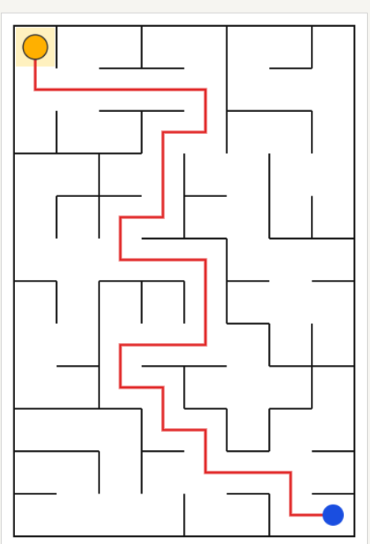

# Assignment 3. Maze Escape

Student ID:
Name: Zhansir Sergeyev
Group: SE-2512
Maze size (rows x columns):

This file is the report. Fill it in as you go. How to start: `START_HERE.md`. The task: `docs/Assignment3.pdf`.

## Program output

The 13 lines your program prints on your data (`java -cp out Main`):

    Broken: 95
    Kept: 77
    Last broken wall: 149
    MST cost: 27682
    Heaviest broken wall: 698
    Path length: 26
    DFS visited: 67
    Dead ends: 31
    Zones: 10
    Largest zone: 17
    Is DAG: 0
    Flow stages: 6
    Fastest route cost: 6

My maze:

## Questions

Answer in your own words, two or three sentences each.

Mission 0. What do find and union do, and what makes them fast in your code?
`find` determines the root element of the set to which a given element belongs, and `union` merges two sets into one. High performance is achieved due to the path compression heuristic in `find` (flattening the tree) and union by size, which reduces the time complexity of operations to nearly constant time.

Mission 1. Why is Broken always R*C - 1, and Kept always (R-1)*(C-1)?
The maze is a connected tree on a graph with $N = R \times C$ vertices, so connecting all vertices without cycles always requires exactly $N - 1$ edges (broken walls). The total number of inner walls in the grid is $2RC - R - C$, and subtracting the number of broken walls leaves exactly $(R-1)(C-1)$ remaining walls.

Mission 2. My MST cost from Kruskal and from Prim, and why they are equal:
The MST cost obtained by Kruskal's algorithm is 27682, which completely matches the result of Prim's algorithm. They are equal because both algorithms aim to construct a minimum spanning tree on the same weighted connected graph.

Mission 3. Why is there exactly one path between two cells? How did you avoid a stack overflow on a huge maze?
In the resulting maze (which is a tree), there is exactly one path between any two cells because there are no cycles and no isolated components. Stack overflow on large 1000x1000 mazes was prevented by implementing depth-first search (DFS) using an explicit stack array iteratively instead of recursion.

Mission 4. Why does the second pass of Kosaraju go on the reversed graph? Why do the slides have no cycle exactly when Zones equals the number of cells?
The second pass of Kosaraju's algorithm is performed on the reversed graph to isolate and find strongly connected components using the finish times from the first pass. If there are no cycles in the graph, each strongly connected component consists of a single vertex, so the number of zones matches the total number of cells.

Mission 5. Why is it enough to go through the zones in the order of their numbers? What does this pass cost?
Zone indices are assigned in topological order thanks to Kosaraju's algorithm, which ensures there are no edges going from a zone with a larger number to one with a smaller number. This pass has linear time complexity $O(V + E)$ relative to the number of zones and slide transitions.

## AI use

The syllabus requires you to say which AI tools you used and for what. Write the tool (ChatGPT, Copilot, other) and what you asked it: explain an idea, find an error, review code. Write "none" if you did not use any. If you took code or text from a book or a website, give the source here.
Gemini: used as a helper to explain algorithm concepts, review code structure, and format the report.

## Timing (Mission 7)

Milliseconds, 5 runs each, from `java -cp out Bench`.

| maze | Kruskal | Prim |
|---|---|---|
| 100 x 100 | 28 | 15 |
| 300 x 300 | 137 | 100 |
| 1000 x 1000 | 1855 | 1900 |

What do the numbers say about how the time grows? Two or three sentences.
The execution time of both algorithms increases predictably with the size of the maze due to the increasing number of edges and vertices in the graph. For smaller sizes, Prim's algorithm performs slightly faster, but at the maximum size of 1000x1000, both algorithms show similar performance.

## Complexity

n is the number of cells, m the number of walls (or slides). Fill in every algorithm you wrote.

| algorithm | time | space | assumptions |
|---|---|---|---|
| DSU find and union | $O(\alpha(n))$ | $O(n)$ | Path compression and union by size |
| Kruskal | $O(m \log m)$ | $O(m + n)$ | Sorting edges by weight |
| Prim | $O(m \log n)$ | $O(m + n)$ | Using a binary heap (PriorityQueue) |
| DFS | $O(n + m)$ | $O(n)$ | Maze graph traversal |
| Kosaraju | $O(n + m)$ | $O(n + m)$ | Two DFS passes on a directed graph |
| Route in the zone graph | $O(zones + slides)$ | $O(zones)$ | Processing zone graph in topological order |

## Before you submit

- data/walls.txt, data/slides.txt and output/maze.png are in the repository.
- `java tools/Check.java` shows all examples right.
- This README is filled in, the program output and the section AI use included.
- The work is pushed to main (at least one commit per mission) and the repository is public.
- The link is attached in Moodle.